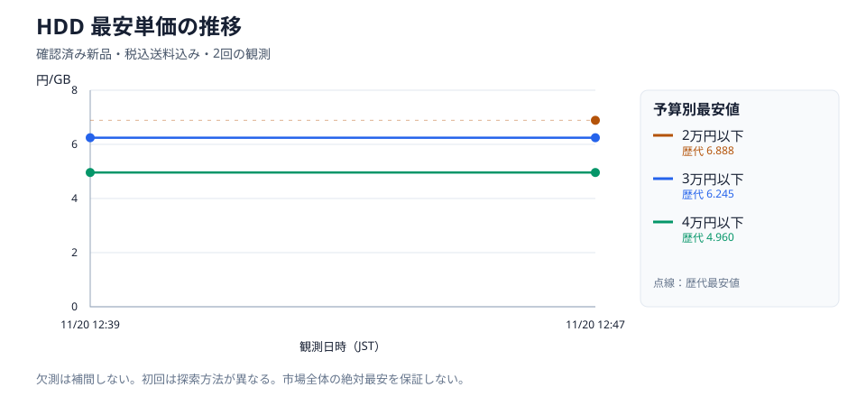

# HDD価格履歴

Amazon.co.jp・楽天市場の観測から、新品・購入可能・税込送料込みの最安円/GBを予算別に追跡する。

## 最安単価の推移

[歴代最安値・各回の履歴（JSON）](stats/summary.json) · [観測データの仕様](DATA_FORMAT.md)

## 集計ルール

- 予算は2万円以下、3万円以下、4万円以下の累積条件。同一商品が複数の予算枠に該当する場合は各枠で集計する。
- 各枠について全体・内蔵・外付けの今回最安値と歴代最安値を保存する。中古・再認定品・在庫不明・送料不明は除外する。
- stats/summary.json v2: budgets_jpyは予算一覧、all_time_bestは予算額の文字列キーごとにoverall/internal/externalを保持。historyの各回にはrun_id、observed_at、observation_path、market_results、best_by_budget（all_time_bestと同じキー構成）を保持する。
- 円/GBの比較は丸め前の比率で行う。基準は保存済みの有効観測。未取得の回は欠測（null）とする。
- 各予算枠の全体歴代最安値を厳密に下回った場合のみ通知する。初回基準値、同値、欠測、内蔵・外付けのみの更新は通知対象外。複数枠が更新された場合は1通にまとめる。
- record_eventsに予算枠、旧・新記録、run_id、通知状況を記録する。公開リポジトリにはメールアドレスやメール本文・認証情報を保存しない。
- 最安値は商品、販売店、容量、支払総額、日時、URL、元データへのパスとともに保持する。
- グラフは予算別の最安単価を3系列で表示し、欠測を補間しない。検索範囲が変動するため、市場全体の絶対最安を保証するものではない。

現在、実測データは未登録。グラフは定期調査で更新する。
